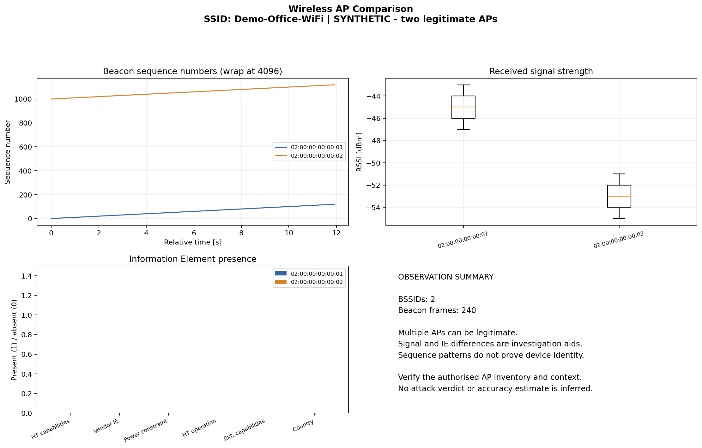

# Synthetic example

This example is generated from artificial Beacon frames for two **legitimate** access points advertising one SSID. It demonstrates the export and plotting workflow, not a successful attack or measured detection accuracy. MAC addresses use the locally administered example range.

The tool flags multiple BSSIDs as an investigation observation. Confirming maliciousness requires external context and an authorised AP inventory.

- [JSON export](synthetic-analysis.json)
- [CSV export](synthetic-analysis.csv)
